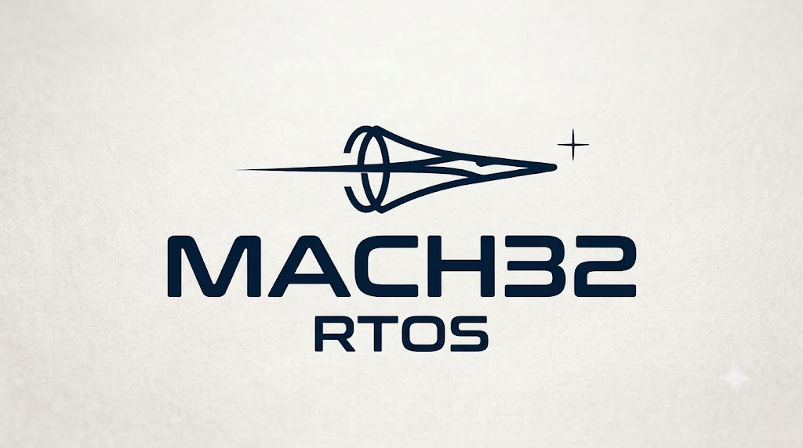

# MACH32-RTOS



A DC motor controller for the NUCLEO-F446RE, built with FreeRTOS and [MACH32](https://github.com/ramselvaraj/MACH32) drivers.

Firmware builds and host tests pass. Hardware validation remains pending.

## Features

- PWM power and direction control through an L293D.
- Potentiometer input or UART commands.
- STOP commands and communication timeouts.
- Watchdog supervision of task progress.
- State, fault, timing, and stack reports.

## Hardware

NUCLEO-F446RE, DC motor, L293D, potentiometer, breadboard, wires, and a suitable power source.
The components come from the [Freenove FNK0020 kit](https://store.freenove.com/products/fnk0020), except the STM32 board and power source.

## Build and test

Requires GNU Make, Arm GCC with newlib, a host C compiler, Git, and Python 3.10 or later.

```sh
make deps
make verify
make test
```

**Motor output is disabled by default.** Check the [wiring guide](docs/wiring.md) before you enable motion.
See [serial commands](docs/protocol.md) for operation.

## References

- [STM32F446 datasheet](https://www.st.com/resource/en/datasheet/stm32f446mc.pdf)
- [RM0390 reference manual](https://www.st.com/resource/en/reference_manual/rm0390-stm32f446xx-advanced-armbased-32bit-mcus-stmicroelectronics.pdf)
- [UM1724 Nucleo-64 user manual](https://www.st.com/resource/en/user_manual/um1724-stm32-nucleo64-boards-mb1136-stmicroelectronics.pdf)
- [PM0214 Cortex-M4 programming manual](https://www.st.com/resource/en/programming_manual/pm0214-stm32-cortexm4-mcus-and-mpus-programming-manual-stmicroelectronics.pdf)
- [L293D datasheet](https://www.ti.com/lit/ds/symlink/l293.pdf)
- [FreeRTOS documentation](https://www.freertos.org/Documentation/00-Overview)
- [FreeRTOS Cortex-M interrupt guide](https://www.freertos.org/Documentation/02-Kernel/03-Supported-devices/04-Demos/ARM-Cortex/RTOS-Cortex-M3-M4)
- [FreeRTOS-Kernel V11.3.2](https://github.com/FreeRTOS/FreeRTOS-Kernel/tree/V11.3.2)
- [Freenove motor tutorial](https://docs.freenove.com/projects/fnk0020/en/latest/fnk0020/codes/c-lang/Motor%20%26%20Driver.html)
